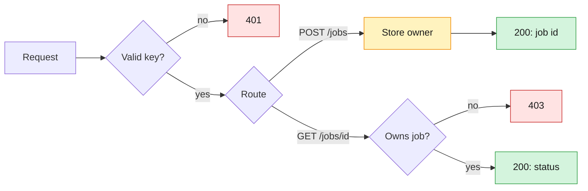

# colony

The application layer of a distributed system, organized like an ant colony.

## Why this exists

`reliable-redis` is the worker ants — jobs get queued, retried, and tracked. `colony`
is everything around that: the guard ants checking who's allowed in (auth), the
chambers that hold persistent state (Postgres), and the division of labor as the
system grows into separate services. This repo is that layer, built the same way as
`reliable-redis` — naive first, fix the specific gap observed.

## API reference

Run the server, then see `/docs` (Swagger UI) or `/redoc` (ReDoc) for the full list
of endpoints, request/response shapes, and descriptions — generated straight from
the code, so it never goes stale.

## Not built yet

- **Hashed API keys** — keys are stored in plaintext in Postgres. Production stores
  only a hash and shows the key once, at creation.
- **Migrations** — tables are created with `Base.metadata.create_all`; no Alembic yet,
  so schema changes are manual.
- **Job persistence** — job owners and statuses live only in Redis (statuses expire
  via TTL); only foragers (API callers) are in Postgres.
- **Async I/O** — endpoints and DB calls are sync; FastAPI runs them in a thread pool.
  Async comes once load testing shows the pool is the bottleneck.
- **Service split** — code is split into modules (`auth.py`, `jobs.py`), a modular
  monolith, but it's still one process and one deploy. Separate services wait for a
  real reason to split.

## Requirements

- Python 3.14, managed with `uv`
- A running Redis server
- A running PostgreSQL server (developed against 18)
- A C compiler and `pg_config` on your `PATH` — `uv sync` builds `psycopg[c]` from
  source against your local libpq
- A `.env` file — copy `.env.example` and set `database_url`

## Quickstart

Clone and install:

```bash
git clone https://github.com/Gagan-Polukonda/colony.git
cd colony
uv sync
```

Create your `.env`:

```bash
cp .env.example .env
```

Then set `database_url` to match your Postgres user, e.g.
`postgresql+psycopg://<user>:<password>@localhost:5432/colony` (drop `:<password>`
if your local Postgres uses trust auth).

Install Redis if you don't have it:

```bash
docker run -d --name redis -p 6379:6379 redis   # any OS, incl. Windows via Docker Desktop
# or: brew install redis && brew services start redis   (macOS)
# or: sudo apt install redis-server                      (Linux)
```

Native Windows without Docker: use [Memurai](https://www.memurai.com/) (Redis's official
Windows-compatible partner) instead.

Start Redis:

```bash
redis-server --daemonize yes
```

Install PostgreSQL if you don't have it:

```bash
docker run -d --name postgres -p 5432:5432 -e POSTGRES_PASSWORD=<password> postgres   # any OS
# or: brew install postgresql@18 && brew services start postgresql@18   (macOS)
# or: sudo apt install postgresql                                         (Linux)
```

Native Windows without Docker: use the official installer from
[postgresql.org](https://www.postgresql.org/download/windows/).

Create the database, schema, and tables:

```bash
createdb colony
psql colony -c "CREATE SCHEMA users;"
uv run python -c "from models import Base; from db import engine; Base.metadata.create_all(engine)"
```

`createdb` and `psql` connect as your OS user by default — if your Postgres user is
different (e.g. Docker's `postgres`), set `PGHOST=localhost`, `PGUSER`, and
`PGPASSWORD` first.

Create your first forager (an API caller) and its key:

```bash
KEY=$(openssl rand -hex 32)
psql colony -c "INSERT INTO users.foragers (username, api_key) VALUES ('<username>', '$KEY');"
echo "$KEY"
```

Save the printed key — that's your `X-API-Key`.

Run the server:

```bash
uv run uvicorn main:app --reload
```

Optional — only if you want the server to auto-restart when `.env` changes (already covered
by this repo's `uvicorn[standard]` dependency, nothing extra to install):

```bash
uv run uvicorn main:app --reload --reload-include ".env"
```

Then open `http://127.0.0.1:8000/docs`, click **Authorize**, and paste your key.

## How it works



Keys are checked against Postgres (`users.foragers`); job owners and statuses live in
Redis.

## Project structure

```
colony/
├── main.py        # app wiring: Redis lifespan, routers, /health
├── auth.py        # who are you? API key → Postgres lookup (401)
├── jobs.py        # /jobs router: submit + status, ownership check (403)
├── db.py          # SQLAlchemy engine + session factory
├── models.py      # ORM models: users.foragers (API callers)
├── config.py      # typed settings loaded from .env
└── .env.example   # required env vars, no real values
```